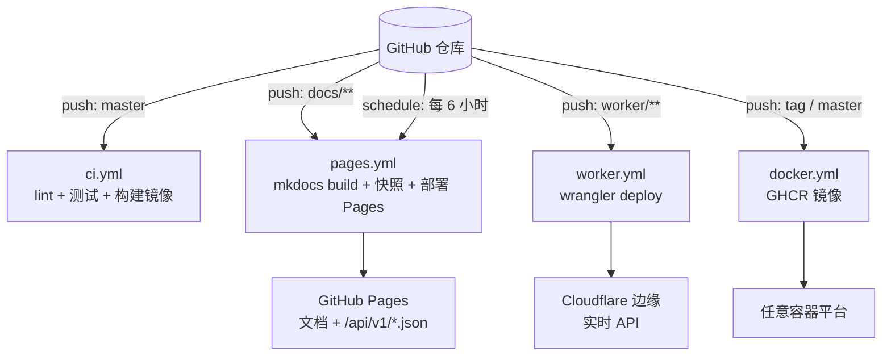

# 部署总览

三种部署方式可以单独使用，也可以组合：**Pages 放文档 + 静态快照**，**Worker 或 Docker 提供实时 API**。

## 对比

| 能力 | GitHub Pages | Cloudflare Worker | Docker / 自建 |
| --- | --- | --- | --- |
| 实时抓取豆瓣 | ❌ 定时快照 | ✅ | ✅ |
| 任意关键词搜索 | ❌ 仅索引内过滤 | ✅ | ✅ |
| 成本 | 免费 | 免费额度内 | 取决于服务器 |
| 部署所需 Secrets | 无 | `CLOUDFLARE_API_TOKEN`、`CLOUDFLARE_ACCOUNT_ID` | 无 |
| 冷启动 | 无（CDN） | ~0 ms | 取决于平台 |
| 自定义域名 | ✅ | ✅ | ✅ |

## 快速选择

- **只想看文档 / 展示**：[GitHub Pages](pages.md)，合并到 `master` 即自动上线。
- **需要实时 API 且不想运维**：[Cloudflare Worker](worker.md)，配置两个 Secret 后一键部署。
- **有自己的服务器 / 需要 Redis 共享缓存**：[Docker](docker.md)。

## 需要的仓库配置

| 类型 | 名称 | 用途 | 必填 |
| --- | --- | --- | --- |
| Secret | `CLOUDFLARE_API_TOKEN` | Workers 部署（权限：Workers Scripts:Edit） | Worker 部署时 |
| Secret | `CLOUDFLARE_ACCOUNT_ID` | 同上 | Worker 部署时 |
| Variable | `ENABLE_WORKER_DEPLOY` | 设为 `true` 才执行 Worker 部署任务 | 否 |
| Pages | Settings → Pages → Source = **GitHub Actions** | Pages 首次部署后自动配置 | 是 |

!!! tip "没有 Cloudflare 账号？"
    `worker.yml` 会在缺少 Secret 时**跳过**部署任务而不是报错，CI 仍然是绿色的。

## 首次部署 Pages

1. 仓库 Settings → Pages → Build and deployment → Source 选择 **GitHub Actions**；
2. push 到 `master`（或手动运行 `pages` workflow）；
3. 访问 `https://<用户名>.github.io/douban-request-api/`。

静态 API 位于 `https://<用户名>.github.io/douban-request-api/api/v1/`，
清单文件是 `index.json`。
