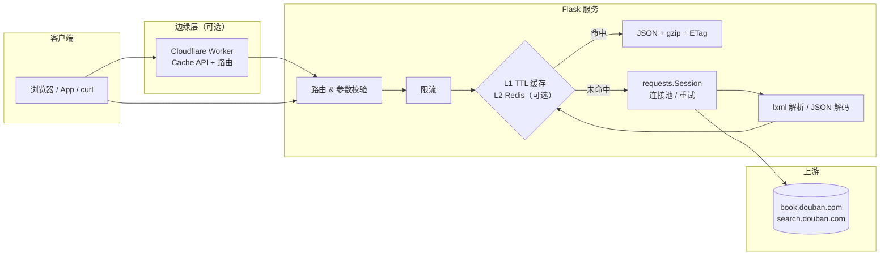

# 豆瓣图书查询 API

基于 Flask + lxml 的豆瓣图书查询接口。v2 重写了抓取、解析、缓存与部署链路：
单次请求耗时从 **~1.0s 降到 ~0.23s**，命中缓存后 **~10µs**，同时提供
GitHub Pages 静态 API、Cloudflare Worker 边缘 API 与 Docker 镜像三种部署方式。

[快速开始](quickstart.md){ .md-button .md-button--primary }
[在线体验](playground.md){ .md-button }
[API 参考](reference.md){ .md-button }

!!! warning "使用前请阅读"
    本项目仅用于学习与研究。数据版权归豆瓣所有，请勿高频遍历、商用或用于任何侵犯
    豆瓣权益的场景。接口默认限流 120 次/分钟，缓存 TTL 5–30 分钟。

## 功能特性

<div class="grid cards" markdown>

- :material-rocket-launch: **快**
  连接池复用、TTL + LRU 缓存、单飞合并、gzip、ETag/304。缓存命中为纯内存查找。

- :material-shield-check: **稳**
  上游超时/重试/404 区分映射、参数校验、限流、过期缓存兜底（stale-while-error）、统一错误码。

- :material-server-network: **可部署**
  GitHub Actions 一键部署：Pages 静态 API + 文档、Cloudflare Worker 边缘 API、GHCR 镜像。

- :material-test-tube: **可验证**
  60 个离线测试（真实 HTML fixture）、OpenAPI 3.1、基准测试脚本、CI 自动跑 lint/test/build。

</div>

## 架构



## 接口一览

| 方法 | 路径 | 说明 | 缓存 TTL |
| --- | --- | --- | --- |
| `GET` | `/api/v1/books/latest` | 最新图书，支持分类与分页 | 300s |
| `GET` | `/api/v1/books/tag` | 按标签获取图书（每页 20 本） | 600s |
| `GET` | `/api/v1/books/{id}` | 图书详情（评分、简介、出版信息） | 1800s |
| `GET` | `/api/v1/search` | 关键词搜索 | 600s |
| `GET` | `/healthz` / `/metrics` | 健康检查 / 运行指标 | — |

旧版路径 `/getNewBook`、`/getType`、`/getBookDetail`、`/search` 继续可用（标记为 deprecated）。

```bash
# 在线（Cloudflare Worker）
curl -s "https://bookapi.oaixiv.org/api/v1/search?q=三体" | jq '.books[0].name'

# 本地
curl -s "http://127.0.0.1:5000/api/v1/search?q=三体" | jq '.books[0]'
```

## 性能概览

| 指标 | v1（旧） | v2（新） | 说明 |
| --- | ---: | ---: | --- |
| 单次最新图书请求（真实豆瓣） | 1017 ms | **231 ms** | 连接复用 + 解析重写 |
| 列表页解析（同份 HTML） | 485 ms | **3.2 ms** | 150× |
| 搜索数据解码 | 62 ms | **0.10 ms** | 豆瓣已返回明文 JSON |
| 缓存命中 | 无 | **~10 µs** | 进程内 TTL + LRU |
| 响应体积（最新图书 JSON） | 8.8 KB | **2.1 KB** | gzip 后 |

详细数据与复现方式见 [性能](performance.md)。

## 部署方式

| 方式 | 适用场景 | 是否实时 | 需要的 Secrets |
| --- | --- | --- | --- |
| [GitHub Pages 静态 API](deployment/pages.md) | 零成本、只读展示、文档 | ❌ 定时快照 | 无（用 `GITHUB_TOKEN`） |
| [Cloudflare Worker](deployment/worker.md) | 免费边缘实时 API | ✅ | `CLOUDFLARE_API_TOKEN` |
| [Docker / 自建](deployment/docker.md) | 完全可控、内网 | ✅ | 无 |

GitHub Pages 只能托管静态文件，因此"API 部署到 Pages"采用的是**定时快照**方案：
每 6 小时由 Actions 抓取热门数据生成 JSON，站点内可直接 `fetch`；需要实时数据时使用
Worker 或自建服务。

## 项目结构

```text
├── src/douban_api/          # 核心包：路由、缓存、解析、快照、OpenAPI
├── api.py                   # 兼容入口（python api.py）
├── worker/                  # Cloudflare Worker 实现（实时边缘 API）
├── docs/                    # MkDocs Material 文档站（自动部署到 Pages）
├── tests/                   # 离线测试 + 真实页面 fixture
├── benchmarks/              # 新旧实现基准测试
├── .github/workflows/       # CI / Pages / Worker / Docker
├── Dockerfile
└── mkdocs.yml
```

## 致谢

- 实时 API：<https://bookapi.oaixiv.org>
- 数据来源：[豆瓣读书](https://book.douban.com/)
- 旧版搜索解密脚本来自本项目历史版本 `main.js`（现已迁移为可选回退模块）
